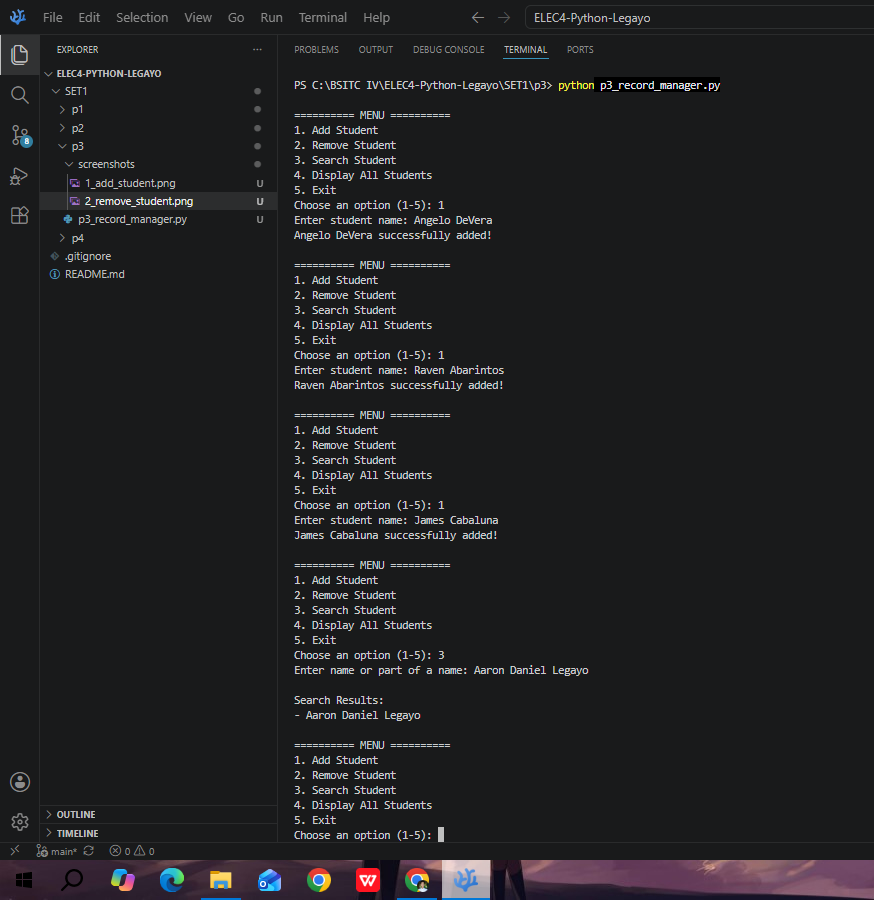
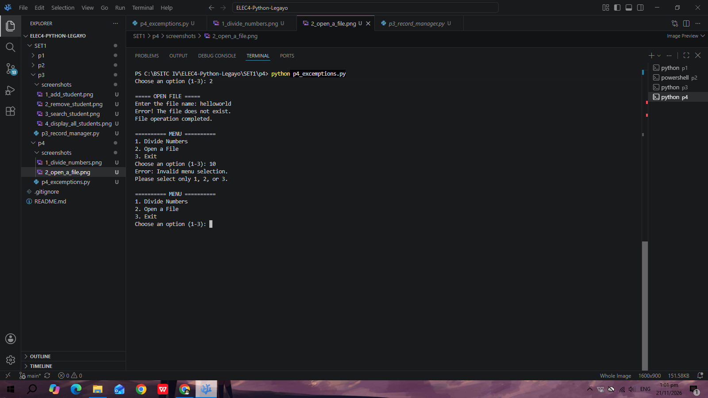
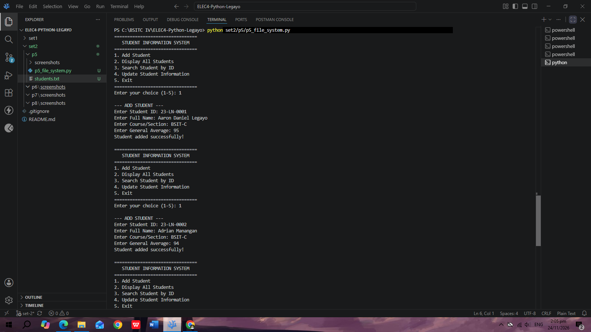
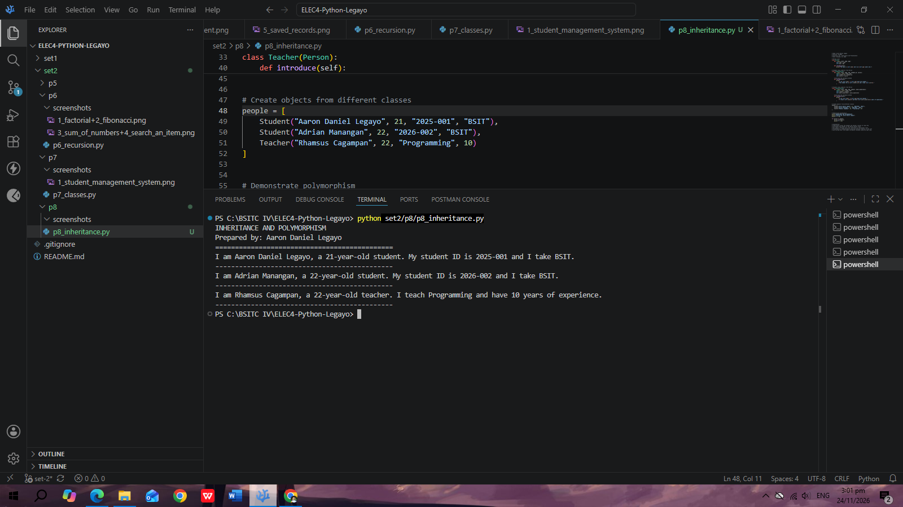

# ELEC4-Python-Legayo

**Name:** Aaron Daniel A. Legayo  
**Section:** BSIT IV-C  
**Course Code and Title:** ELEC 4 – Python Programming

---

## Set 1 Activities

| Activity | Description | Folder |
|---|---|---|
| P1 – Functions | Student Grade Calculator using functions. | [set1/p1](set1/p1/) |
| P2 – Modules | Student Grade Report using a custom Python module. | [set1/p2](set1/p2/) |
| P3 – Lists and Sets | Student Record Manager using lists and sets. | [set1/p3](set1/p3/) |
| P4 – Exceptions | Safe Menu Program demonstrating exception handling. | [set1/p4](set1/p4/) |

## Set 2 Activities

| Activity | Description | Folder |
|---|---|---|
| P5 – File Input and Output | Student Information File System using text file handling. | [set2/p5](set2/p5/) |
| P6 – Recursion | Recursion Toolkit demonstrating four recursive functions. | [set2/p6](set2/p6/) |
| P7 – Classes and Objects | Student Management System using classes, objects, and encapsulation. | [set2/p7](set2/p7/) |
| P8 – Inheritance and Polymorphism | Demonstration of inheritance, method overriding, and polymorphism. | [set2/p8](set2/p8/) |

---

## How to Run Each Activity

Run these commands from the repository's root directory.

### Set 1

**P1 – Grade Calculator**
```bash
python set1/p1/p1_grade_calculator.py
```

**P2 – Custom Module**
```bash
python set1/p2/p2_main.py
```

**P3 – Student Record Manager**
```bash
python set1/p3/p3_record_manager.py
```

**P4 – Safe Menu Program**
```bash
python set1/p4/p4_exceptions.py
```

### Set 2

**P5 – Student Information File System**
```bash
python set2/p5/p5_file_system.py
```

**P6 – Recursion Toolkit**
```bash
python set2/p6/p6_recursion.py
```

**P7 – Student Management System**
```bash
python set2/p7/p7_classes.py
```

**P8 – Inheritance and Polymorphism**
```bash
python set2/p8/p8_inheritance.py
```

---

## Screenshots

### P1 – Grade Calculator
.png)

### P2 – Custom Module
.png)

### P3 – Student Record Manager





### P4 – Safe Menu Program




### P5 – Student Information File System



### P6 – Recursion Toolkit


### P7 – Student Management System


### P8 – Inheritance and Polymorphism

