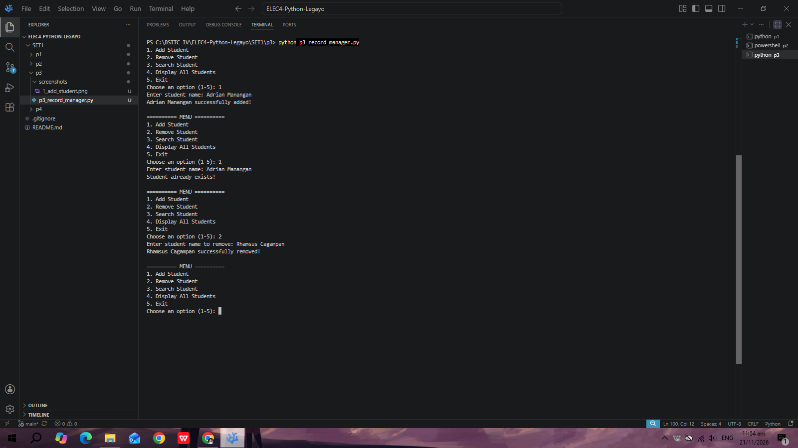
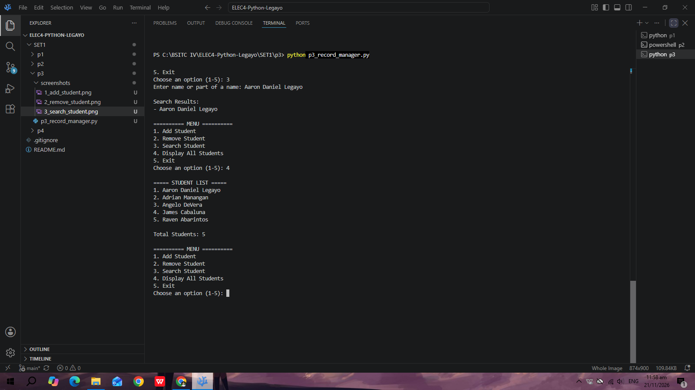
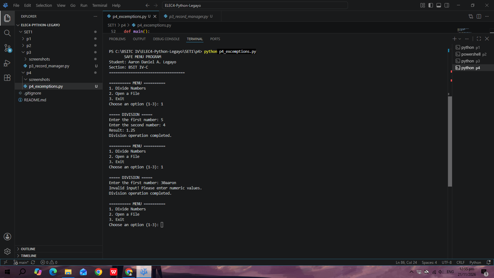
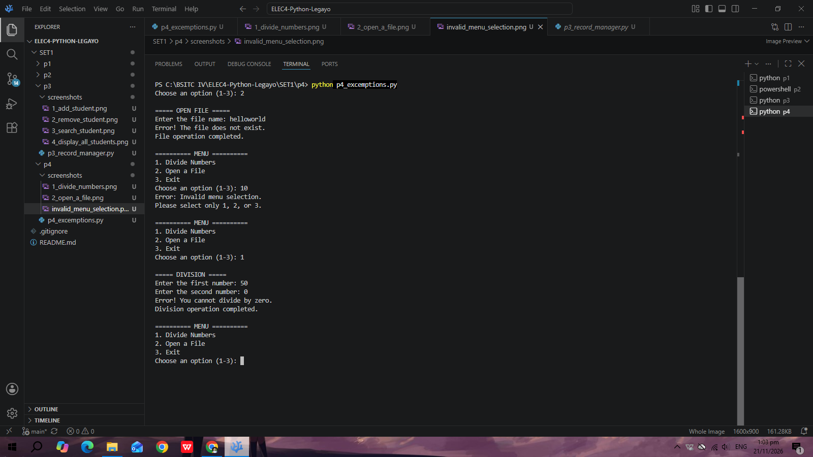
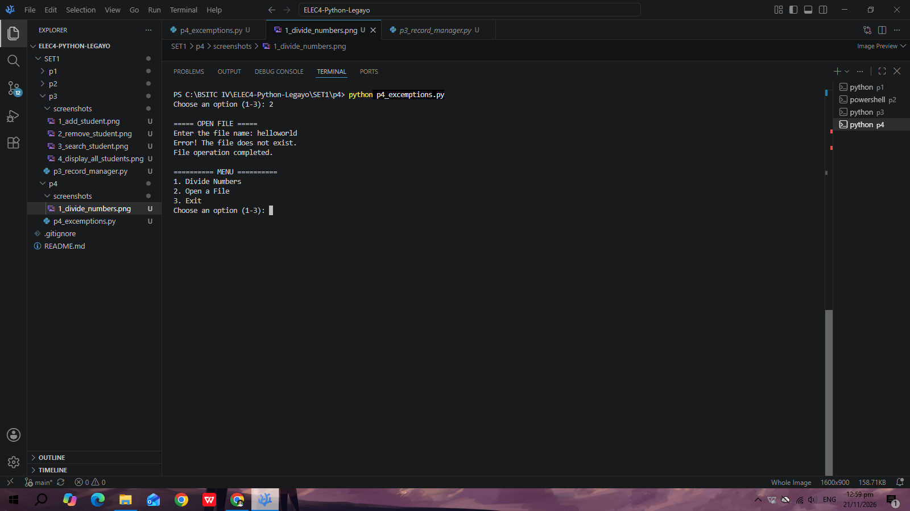

# ELEC4-Python-Legayo

**Name:** Aaron Daniel A. Legayo  
**Section:** BSIT IV-C  
**Course Code and Title:** ELEC 4 – Python Programming

## Set 1 Activities

| Activity | Description | Folder |
|---|---|---|
| P1 – Functions | Student Grade Calculator using functions. | [set1/p1](set1/p1/) |
| P2 – Modules | Student Grade Report using a custom Python module. | [set1/p2](set1/p2/) |
| P3 – Lists and Sets | Student Record Manager using lists and sets. | [set1/p3](set1/p3/) |
| P4 – Exceptions | Safe Menu Program demonstrating exception handling. | [set1/p4](set1/p4/) |

## How to Run Each Activity

Run these commands from the repository's root directory:

**P1 – Grade Calculator**
```bash
python set1/p1/p1_grade_calculator.py
```

**P2 – Custom Module**
```bash
python set1/p2/p2_main.py
```

**P3 – Student Record Manager**
```bash
python set1/p3/p3_record_manager.py
```

**P4 – Safe Menu Program**
```bash
python set1/p4/p4_exceptions.py
```

## Screenshots

### P1 – Grade Calculator
.png)

### P2 – Custom Module
.png)

### P3 – Student Record Manager







### P4 – Safe Menu Program








