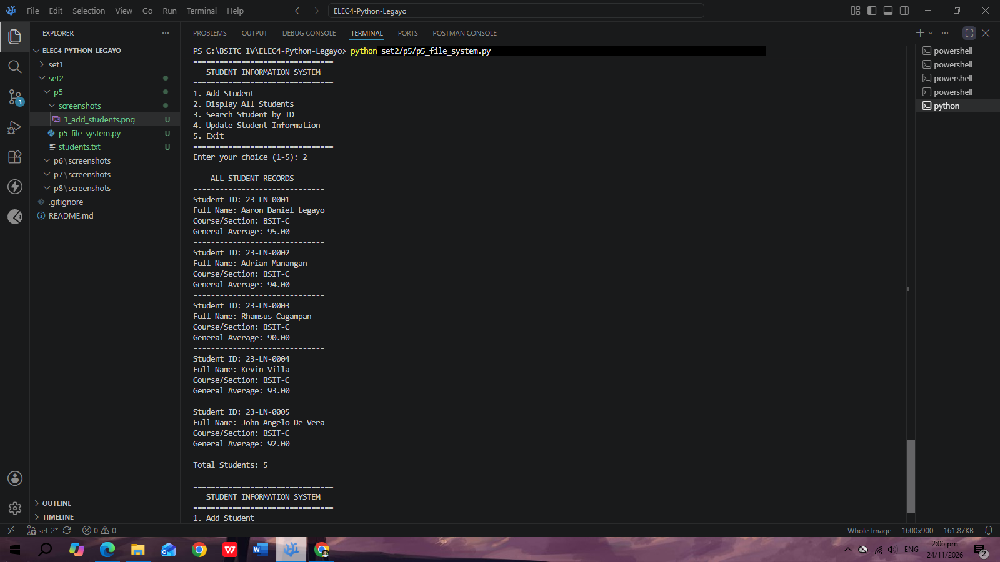
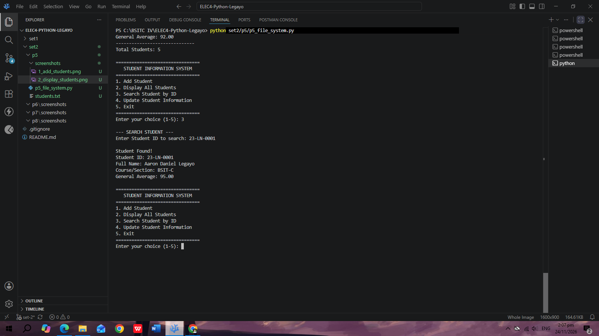
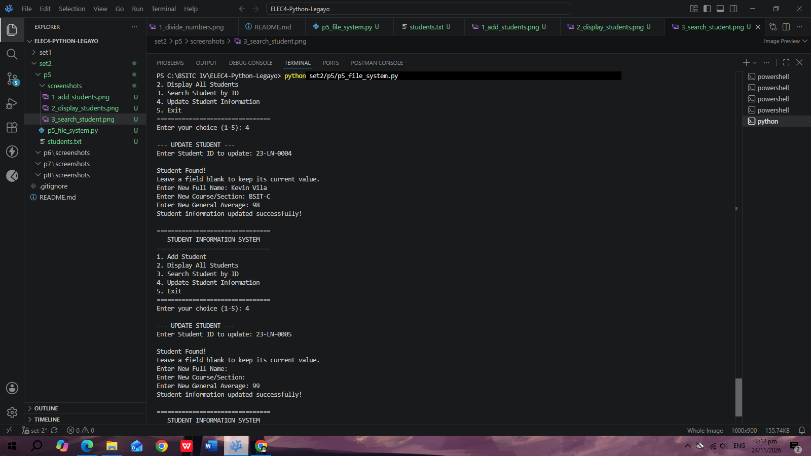
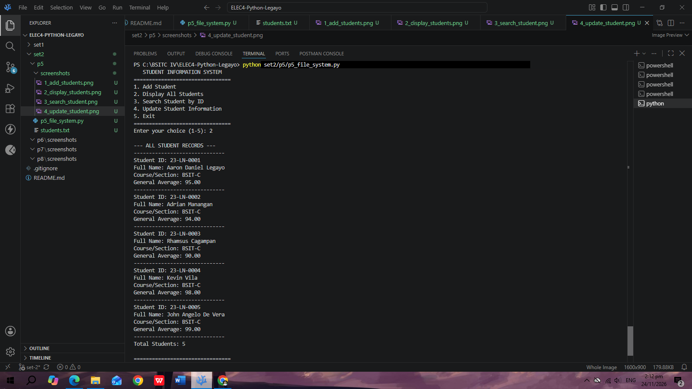
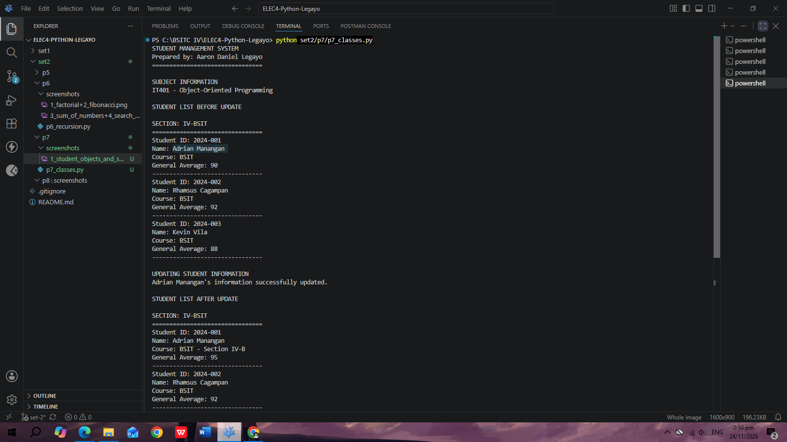

# ELEC4-Python-Legayo

**Name:** Aaron Daniel A. Legayo  
**Section:** BSIT IV-C  
**Course Code and Title:** ELEC 4 – Python Programming

---

## Set 2 Activities

| Activity | Description | Folder |
|---|---|---|
| P5 – File Input and Output | Student Information File System using text file handling. | [set2/p5](set2/p5/) |
| P6 – Recursion | Recursion Toolkit demonstrating four recursive functions. | [set2/p6](set2/p6/) |
| P7 – Classes and Objects | Student Management System using classes, objects, and encapsulation. | [set2/p7](set2/p7/) |
| P8 – Inheritance and Polymorphism | Demonstration of inheritance, method overriding, and polymorphism. | [set2/p8](set2/p8/) |

---

## How to Run Each Activity

Run these commands from the repository's root directory.


### Set 2

**P5 – Student Information File System**
```bash
python set2/p5/p5_file_system.py
```

**P6 – Recursion Toolkit**
```bash
python set2/p6/p6_recursion.py
```

**P7 – Student Management System**
```bash
python set2/p7/p7_classes.py
```

**P8 – Inheritance and Polymorphism**
```bash
python set2/p8/p8_inheritance.py
```

---

## Screenshots


### P5 – Student Information File System










### P6 – Recursion Toolkit


### P7 – Student Management System


### P8 – Inheritance and Polymorphism

